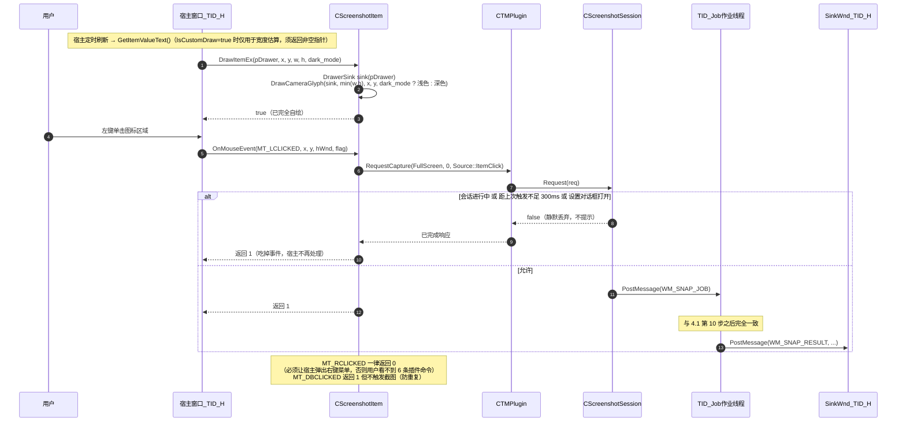
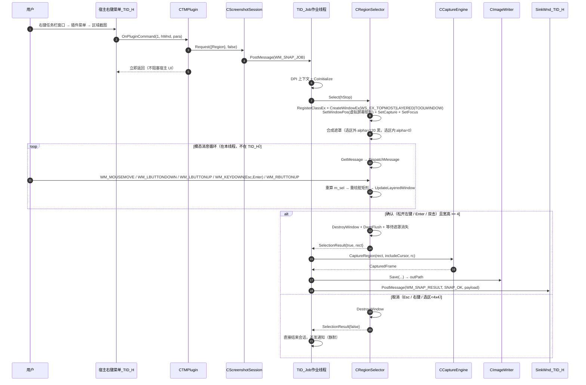
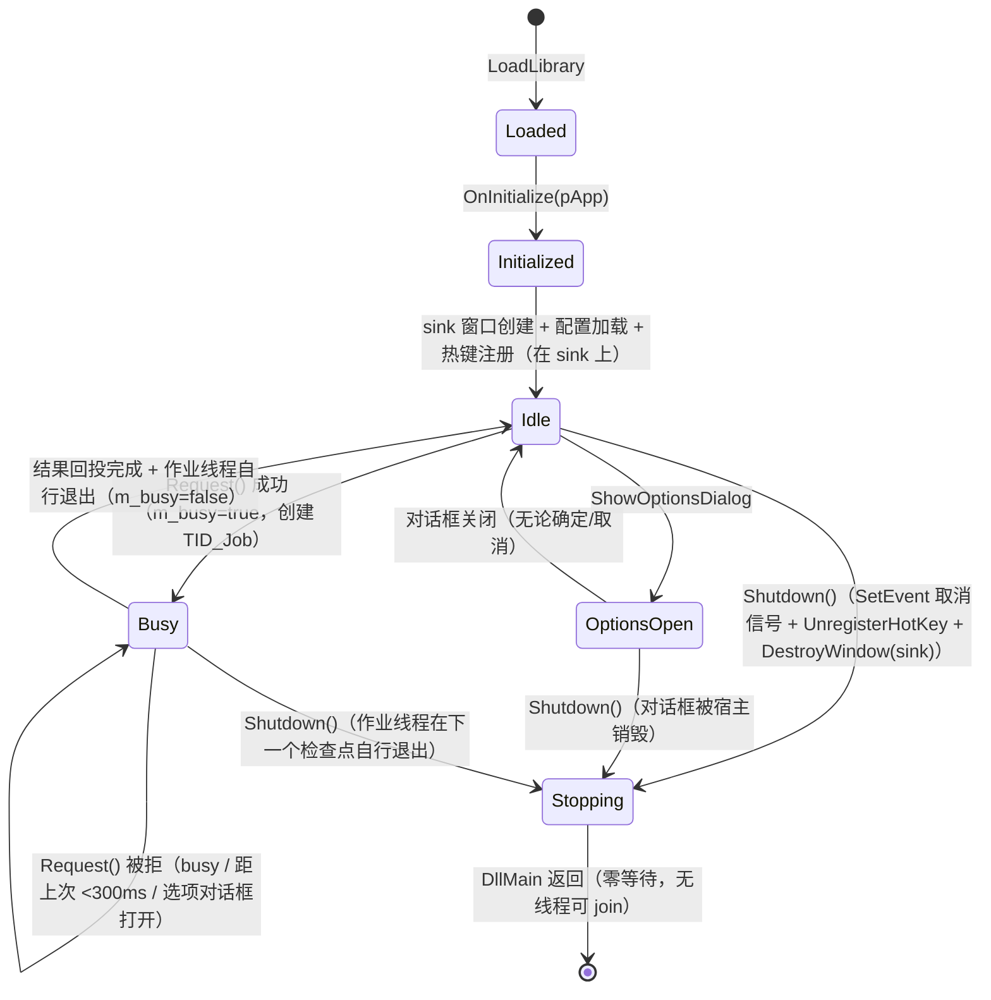

# TMPluginScreenshot 系统设计（ARCHITECTURE）

| 项 | 内容 |
| --- | --- |
| 产品 | TrafficMonitor 截图插件（`TMPluginScreenshot.dll`） |
| 宿主 | TrafficMonitor 1.8.6 x64，插件接口 API version 8 |
| 目标平台 | Windows x64（宿主为 x64，插件必须同位数） |
| 技术栈 | 纯 C++17 / Win32 API + WIC（`windowscodecs.lib`）；无 MFC、无 ATL、无 GDI+、无第三方库；`/MT` 静态 CRT |
| 唯一导出 | `extern "C" __declspec(dllexport) ITMPlugin* TMPluginGetInstance();` |
| 需求来源 | `docs/PRD.md`（18 条 P0 + 4 决策点 + 2 实现约束），本文不做需求增删 |
| 接口来源 | `include/PluginInterface.h`（宿主官方头文件，只读引用，不修改） |
| 文档版本 | v1.0 |

---

## 1. 方案总览与选型

### 1.1 核心难点

| # | 难点 | 本质问题 |
| --- | --- | --- |
| D1 | 插件没有"主界面按钮"扩展位 | 只能用「显示项目自绘区域」承担主界面按钮的职责：必须自己画图标、自己接鼠标事件、必须把点击"吃掉"并保证不多截 |
| D2 | 三条互不相干的触发源（宿主 UI 线程回调 / 鼠标 / 全局热键线程） | 必须收敛到**唯一一条会话管线**，否则并发抓屏、重复保存、热键线程回收全部失控 |
| D3 | 宿主 UI 线程绝对不能阻塞 | 抓屏 + WIC 编码 + 落盘可能 100~600ms；延时截图可达 30s；区域选择要跑模态消息循环。三者都不能跑在宿主 UI 线程 |
| D4 | 混合 DPI / 负坐标多屏 | 抓屏与框选必须严格使用**物理像素 + 虚拟屏幕坐标系**；宿主给插件项目的坐标是已缩放的，两边不能混用 |
| D5 | DLL 卸载时热键与线程的安全回收 | 不能持有常驻线程：`DllMain(DETACH)` 持 loader lock 期间 join 自建线程必然死锁（线程退出要 `LdrShutdownThread` 拿同一把锁）。见 §5.1 |
| D6 | 零依赖约束下的 UI 实现 | 没有 .rc 资源、没有 comctl32 的前提下，模态设置对话框与自绘覆盖层都要手写 |

### 1.2 选型表

| 决策点 | 选择 | 备选 | 选择理由 |
| --- | --- | --- | --- |
| 图像编解码 | **WIC（`windowscodecs.lib`）** | GDI+（`gdiplus.lib`） | WIC 是 COM 化的系统组件，PNG/JPG/BMP 编码器齐全，JPG 质量可精确控制（`ImageQuality` 属性）；GDI+ 需要额外的 GDI+ 初始化（`GdiplusStartup`）与 `.lib`，且在容器/无 GDI+ 环境下更脆弱。WIC 直接吃我们已有的 `32bppBGRA` DIB 缓冲区（`CreateBitmapFromMemory`），零拷贝路径短。 |
| 主构建方式 | **`build.bat` → `call vcvars64.bat && cl /LD`** | CMake | 实测 `cmake` 不在 PATH；而 `vcvars64.bat` 存在。一条 `cl` 命令即可产出 DLL，无中间工程文件，Engineer 与 QA 都能一条命令复现。`CMakeLists.txt` 作为可选备选提供（不参与验收）。 |
| C 运行库 | **`/MT`（静态 CRT）** | `/MD`（动态 CRT） | 插件被宿主 `LoadLibrary` 到宿主进程，若用 `/MD`，一旦目标机器缺少 `VCRUNTIME140.dll`/`MSVCP140.dll`，**整个 TrafficMonitor 都加载不起来**（宿主本身可能不依赖 VC 运行库）。`/MT` 让插件自带 CRT，依赖表只剩系统 DLL。代价是 DLL 体积变大（~200KB），可接受。 |
| 设置对话框 | **`DialogBoxIndirectParamW` + 内存 `DLGTEMPLATE`** | ① `.rc` 资源 + `DialogBoxParam`；② `CreateWindowExW` 自建模态窗口 | ①要引入 `rc.exe`/`.res` 到构建链，且资源在 DLL 里需要 `hInstance`，`build.bat` 复杂度上升；②要自己实现模态消息禁用循环（`IsDialogMessage`/`EnableWindow`），易出焦点 bug。`DialogBoxIndirectParamW` 用运行时拼的模板达到"有 `.rc` 的效果"，同时保留系统模态语义（自动禁用父窗口、`Esc`/`IDCANCEL`、`Tab` 导航、`IsDialogMessage`），是零资源约束下的最优解。 |
| 区域覆盖层 | **`UpdateLayeredWindow` + 32bpp 逐像素 Alpha DIB** | ①`SetLayeredWindowAttributes(LWA_ALPHA)`；②`LWA_COLORKEY` | `LWA_ALPHA` 只能整窗统一透明度，**选区内无法"提亮"**（选区内外只能一个 alpha），且无法做柔和边缘；`LWA_COLORKEY` 是色键，边缘锯齿、且会误伤同色像素。`UpdateLayeredWindow` 能做"选区外 40% 黑、选区内完全透明"，这是 PRD §5.3 想要的观感。代价是一次虚拟屏幕大小 DIB（3×1080p ≈ 25MB，3×4K ≈ 100MB），用虚拟屏幕像素数阈值做降级保护（见 §9 风险 R6）。 |
| 覆盖层窗口数量 | **单个覆盖整个虚拟屏幕的窗口** | 每显示器一个窗口 | 单窗口天然支持"从 A 屏拖到 B 屏"，没有跨窗拖拽的坐标系切换与接缝；负坐标只需把虚拟屏幕矩形直接传给 `SetWindowPos`。这是对 PRD §5.3「每个显示器创建覆盖窗口」的**实现简化**（用户可见行为完全一致），已列入 §10 待裁决项。 |
| 活动窗口抓取方式 | **`GetForegroundWindow` + `DwmGetWindowAttribute(DWMWA_EXTENDED_FRAME_BOUNDS)` + 从屏幕 DC `BitBlt`** | `PrintWindow(PW_RENDERFULLCONTENT)` | 屏幕 BitBlt 天然兼容 DWM 合成、硬件加速窗口（视频、浏览器、Electron），结果 = 用户看到的像素；`PrintWindow` 在部分硬件渲染窗口上返回黑图。`EXTENDED_FRAME_BOUNDS` 用于剔除 Win10/11 的窗口阴影与不可见边框。代价：被遮挡的窗口截到的是遮挡内容（PRD 未要求，列入风险）。 |
| 热键录制控件 | **普通 `BUTTON`/`STATIC` 子类化 + `WM_KEYDOWN`/`WM_SYSKEYDOWN` 录制** | `msctls_hotkey32`（HOTKEY_CLASS） | 后者在 `comctl32.dll` 里，会让 `dumpbin /dependents` 多出 `COMCTL32.dll`，与 PRD R-01 的依赖白名单（kernel32/user32/gdi32/ole32/windowscodecs/shlwapi 等系统 DLL）核对口径产生歧义。自绘录制约 80 行，且能做"仅修饰键报错"的即时反馈。 |
| 数值微调控件（延时秒 / JPG 质量） | **`EDIT`(`ES_NUMBER`) + 两个普通 `BUTTON`（−/+）** | `msctls_trackbar32` / `msctls_updown32` | 同样为了**不引入 `comctl32.dll`**。是对 PRD §5.2「滑块 1–100」与「数值框+Spin」的控件形态替换，行为等价（连续可调 + 范围校验），已列入 §10 待裁决项。 |
| 线程模型 | **宿主 UI 线程（sink 窗口）+ 一次作业一个线程** | 两个常驻线程（原设计，已废弃） | 常驻线程与"可被 `FreeLibrary` 卸载"二者不可兼得：`DllMain(DETACH)` 持 loader lock，而线程退出要拿同一把锁 → join 必然超时 → unmap 后崩溃（§5.1 有 6063ms 的对照实验）。作业线程跑完自行退出，`DllMain` 零等待，会话互斥由 `m_busy` + 300ms 防抖承担。 |
| 字符串工具 | **`std::wstring` + `_snwprintf_s`** | 手写 `wchar_t` 缓冲管理 | `/MT` 下 STL 完全静态、无额外 DLL 依赖；`std::wstring` 让文件名模板、tooltip、日志的拼接不易溢出。注意：持有 `std::wstring` 的对象必须是"故意不析构"的静态对象（见 §5.5）。 |
| 配置持久化 | **`GetPrivateProfileStringW` / `WritePrivateProfileStringW`** | 自写 ini/JSON 解析器 | 系统 API，零代码量、零 bug 面。唯一坑是首次写文件时的编码（必须预建 UTF-16LE BOM，见 §6.6）。 |
| DPI 感知方式 | **`SetThreadDpiAwarenessContext(PER_MONITOR_AWARE_V2)`，动态 `GetProcAddress` 解析** | ①静态导入；②`SetProcessDpiAwarenessContext` | ①静态导入会让 DLL 在旧系统上加载失败（`user32` 找不到导出）；②**改整个宿主的 DPI 感知是越权行为**，会让 TrafficMonitor 自己的界面变形，绝对禁止。只用线程级，且只作用于我们自己创建的线程，宿主 UI 线程（`TID_H`）一次都不碰。 |

### 1.3 架构模式

采用**三层 + 单管线**结构：

```
宿主回调层（TID_H）  CTMPlugin / CScreenshotItem  ← 只做参数校验、状态读写、投递任务，全部 O(1)
        │  (请求收敛：300ms 防抖 + 会话互斥)
        ▼
作业线程（TID_Job，一次一个）  CScreenshotSession::JobThreadProc → (CRegionSelector) → CCaptureEngine → CImageWriter
        │  (结果回投：PostMessage 到 TID_H 的 sink 窗口)
        ▼
宿主呈现层（TID_H）  ShowNotifyMessage / GetTooltipInfo / InvalidateRect
```

所有跨线程状态收敛在 `CScreenshotSession`（`std::atomic<bool> m_busy` + `ULONGLONG m_lastTick`）与一个"结果消息"上，**不存在共享的可变字符串/容器跨线程访问**（结果通过堆载荷传递所有权）。

---

## 2. 目录与文件清单

> 源码/头文件共 **14 个**（`include/PluginInterface.h` 为宿主提供的只读接口头，不计入）。构建与文档产物 6 个。

| 相对路径 | 类型 | 职责（一句话） | 预估行数 |
| --- | --- | --- | --- |
| `include/PluginInterface.h` | 宿主提供 | 官方插件接口定义，**只读**，任何情况下不修改 | 617（已有） |
| `src/PluginSettings.h` | 头 | **公共基座头**：平台宏、系统头包含（`windows.h`/`shellapi.h`/`shlwapi.h`/`dwmapi.h` + COM/WIC 前置头 `objbase.h`/`oleauto.h`/`ocidl.h`/`wincodec.h`）、`#pragma comment(lib)`、错误码、日志宏、字符串/路径工具、`ImageFormat`、`HotkeyBinding`、`PluginSettings`、`CPluginSettings`、`CUxText`（i18n）声明 | 190 |
| `src/PluginSettings.cpp` | 源 | ini 读写（含 BOM 预建）、默认值/逐字段回退、配置目录解析、文件名模板展开与非法字符净化、i18n 文案表、日志实现 | 620 |
| `src/CaptureEngine.h` | 头 | `CaptureMode`/`CaptureSource`/`CaptureRequest`/`CapturedFrame`（RAII GDI 帧）/`CCaptureEngine` 声明 | 100 |
| `src/CaptureEngine.cpp` | 源 | 虚拟屏幕几何、全屏/区域/活动窗口抓取、光标绘制、尺寸与内存守卫、安全桌面与全黑判定 | 450 |
| `src/ImageWriter.h` | 头 | `CImageWriter` 声明（WIC 编码、命名去重、目录创建、剪贴板） | 85 |
| `src/ImageWriter.cpp` | 源 | WIC 工厂（每线程）、PNG/JPG/BMP 编码、`CF_DIB`+注册格式 `PNG`、失败清理半成品 | 520 |
| `src/RegionSelector.h` | 头 | `SelectionResult`/`CRegionSelector` 声明（覆盖层一次框选 = 一次调用） | 75 |
| `src/RegionSelector.cpp` | 源 | 覆盖层窗口、32bpp 遮罩合成、橡皮筋/尺寸提示、Esc/Enter/右键/双击、模态循环、取消事件 | 540 |
| `src/OptionsDialog.h` | 头 | `COptionsDialog` 声明 + 控件 ID 常量 + 布局项 | 85 |
| `src/OptionsDialog.cpp` | 源 | 内存 `DLGTEMPLATE` 构建、`WM_INITDIALOG` 精确定位、热键录制子类化、立即截屏、恢复默认、确定/取消 | 680 |
| `src/HotkeyManager.h` | 头 | `CHotkeyManager` 声明（注册在 sink 窗口上的全局热键：注册/换绑/注销） | 45 |
| `src/HotkeyManager.cpp` | 源 | `RegisterHotKey`/`UnregisterHotKey`（宿主 UI 线程）、换绑失败回滚旧绑定 | 93 |
| `src/TMPlugin.h` | 头 | `CTMPlugin`（`ITMPlugin`）、`CScreenshotItem`（`IPluginItem`）、`CScreenshotSession`、`GlyphSink`/`DrawerSink`/`HdcSink` 声明、命令索引常量、自定义消息 ID | 200 |
| `src/TMPlugin.cpp` | 源 | 三个核心类实现 + sink 窗口 + 图标 HICON 生成 + `DllMain` + `TMPluginGetInstance` 导出 | 780 |
| `build.bat` | 构建 | `call vcvars64.bat` + `cl /LD` 一次产出 `bin/TMPluginScreenshot.dll` | 55 |
| `CMakeLists.txt` | 构建（可选） | 备选构建入口，参数与 `build.bat` 严格等价 | 40 |
| `tools/verify.bat` | 构建 | `dumpbin /exports` + `/dependents` 自动核对（依赖白名单、单一导出） | 40 |
| `docs/ARCHITECTURE.md` | 文档 | 本文档 | — |
| `docs/TASKS.md` | 文档 | 任务分解与跨文件约定 | — |
| `docs/README.md` | 文档 | 安装/使用/故障排查 | — |
| `docs/manual-test.md` | 文档 | 实机手工验收清单（对应 PRD 成功标准 1–7） | — |
| `docs/class-diagram.mermaid` / `docs/sequence-diagram.mermaid` | 文档（派生） | 本文档 Mermaid 源码的单独导出，便于离线渲染；**不是构建输入** | — |

**合并说明**：`CScreenshotSession` 与 `CScreenshotItem` 与 `CTMPlugin` 三者共享大量状态（同一份 `CPluginSettings`、同一个 sink 窗口、同一个 tooltip 缓冲），拆成独立 .cpp 会带来为共享状态额外开头的成本，故合并进 `TMPlugin.h/.cpp`。`CCaptureEngine` / `CImageWriter` 保持独立，因为它们是"可脱离宿主单独验证"的纯功能单元（T02 的验收需要它）。

---

## 3. 类图

```mermaid
classDiagram
direction TB

class ITMPlugin {
    <<interface 宿主提供>>
    +GetAPIVersion() int
    +GetItem(int index) IPluginItem*
    +DataRequired() void
    +ShowOptionsDialog(void* hParent) OptionReturn
    +GetInfo(PluginInfoIndex index) const wchar_t*
    +OnMonitorInfo(MonitorInfo) void
    +GetTooltipInfo() const wchar_t*
    +OnExtenedInfo(ExtendedInfoIndex index, const wchar_t* data) void
    +GetPluginIcon() void*
    +GetCommandCount() int
    +GetCommandName(int command_index) const wchar_t*
    +GetCommandIcon(int command_index) void*
    +OnPluginCommand(int command_index, void* hWnd, void* para) void
    +IsCommandChecked(int command_index) int
    +OnInitialize(ITrafficMonitor* pApp) void
}

class IPluginItem {
    <<interface 宿主提供>>
    +GetItemName() const wchar_t*
    +GetItemId() const wchar_t*
    +GetItemLableText() const wchar_t*
    +GetItemValueText() const wchar_t*
    +GetItemValueSampleText() const wchar_t*
    +IsCustomDraw() bool
    +GetItemWidth() int
    +GetItemWidthEx(void* hDC) int
    +DrawItem(void* hDC, int x, int y, int w, int h, bool dark_mode) void
    +DrawItemEx(IPluginDrawer* pDrawer, int x, int y, int w, int h, bool dark_mode) bool
    +OnMouseEvent(MouseEventType type, int x, int y, void* hWnd, int flag) int
    +OnKeboardEvent(int key, bool ctrl, bool shift, bool alt, void* hWnd, int flag) int
    +IsDoubleLineExclusive() int
}

class ITrafficMonitor {
    <<interface 宿主提供>>
    +GetAPIVersion() int
    +GetVersion() const wchar_t*
    +ShowNotifyMessage(const wchar_t* strMsg) void
    +GetLanguageId() unsigned short
    +GetPluginConfigDir() const wchar_t*
    +GetDPI(DPIType type) int
    +GetThemeColor() unsigned int
    +GetMainWindowHwnd() void*
    +GetTaskbarWindowHwnd() void*
}

class IPluginDrawer {
    <<interface 宿主提供>>
    +GetAPIVersion() int
    +DrawWindowText(int x, int y, int w, int h, const wchar_t* s, unsigned long color, Alignment a, bool multi_line, unsigned char alpha) void
    +SetDrawRect(int x, int y, int w, int h) void
    +FillRect(int x, int y, int w, int h, unsigned long color, unsigned char alpha) void
    +DrawRectOutLine(int x, int y, int w, int h, unsigned long color, int width, bool dot_line, unsigned char alpha, int radius) void
    +DrawBitmap(void* hbitmap, int x, int y, int w, int h, StretchMode m, unsigned char alpha) void
    +DrawIcon(void* hIcon, int x, int y, int w, int h) void
    +DrawLine(int x1, int y1, int x2, int y2, unsigned long color, int width, bool dot_line, unsigned char alpha) void
    +GetHDC() void*
}

class CScreenshotItem {
    -CTMPlugin* m_owner
    -wstring m_name
    -wstring m_id
    -wstring m_label
    +GetItemName() const wchar_t*
    +GetItemId() const wchar_t*
    +GetItemLableText() const wchar_t*
    +GetItemValueText() const wchar_t*
    +GetItemValueSampleText() const wchar_t*
    +IsCustomDraw() bool
    +GetItemWidth() int
    +GetItemWidthEx(void* hDC) int
    +DrawItemEx(IPluginDrawer* pDrawer, int x, int y, int w, int h, bool dark_mode) bool
    +DrawItem(void* hDC, int x, int y, int w, int h, bool dark_mode) void
    +OnMouseEvent(MouseEventType type, int x, int y, void* hWnd, int flag) int
    +IsDoubleLineExclusive() int
}

class GlyphSink {
    <<abstract>>
    +Fill(int x, int y, int w, int h, unsigned long color)
    +Frame(int x, int y, int w, int h, unsigned long color, int width, bool dot, int radius)
    +Line(int x1, int y1, int x2, int y2, unsigned long color, int width)
}
class DrawerSink {
    -IPluginDrawer* m_d
    +Fill(...)
    +Frame(...)
    +Line(...)
}
class HdcSink {
    -HDC m_dc
    +Fill(...)
    +Frame(...)
    +Line(...)
}

class CPluginSettings {
    +PluginSettings data
    +wstring configDir
    +wstring iniPath
    +bool Load(const wstring& dir)
    +bool Save() const
    +void ResetToDefault()
    +wstring EffectiveSaveDir() const
    +wstring BuildFileName(const SYSTEMTIME& st) const
    +bool EnsureSaveDir(wstring& err) const
    +wstring ExpandTemplate(const SYSTEMTIME& st) const
}

class PluginSettings {
    <<struct>>
    +wstring saveDir
    +ImageFormat format
    +int jpgQuality
    +wstring fileNameTemplate
    +bool copyToClipboard
    +bool includeCursor
    +bool hotkeyEnabled
    +HotkeyBinding hotkey
    +int delaySeconds
    +bool fallbackToPicturesRoot
    +wstring lastSavedPath
}

class HotkeyBinding {
    <<struct>>
    +UINT modifiers
    +UINT vk
    +bool IsValid() const
    +wstring ToText() const
}

class CUxText {
    -unsigned short m_langId
    +Init(unsigned short hostLangId) void
    +Str(StringId id) const wchar_t*
    +SnapCodeText(SnapCode code) const wchar_t*
}

class CCaptureEngine {
    -bool m_dpiCtxApplied
    +CapturedFrame CaptureFullScreen(bool includeCursor, SnapCode& rc)
    +CapturedFrame CaptureRegion(const RECT& rc, bool includeCursor, SnapCode& rc)
    +CapturedFrame CaptureActiveWindow(bool includeCursor, SnapCode& rc, wstring& err)
    +static RECT VirtualScreenRect()
    +static bool IsSecureDesktop()
}

class CapturedFrame {
    <<struct>>
    +HBITMAP hBitmap
    +HDC hMemDC
    +void* bits
    +int width
    +int height
    +int stride
    +bool IsValid() const
    +void Reset()
}

class CaptureRequest {
    <<struct>>
    +CaptureMode mode
    +int delaySeconds
    +bool includeCursor
    +CaptureSource source
    +RECT region
}

class CImageWriter {
    -IWICImagingFactory* m_factory
    +bool InitThread()
    +void ShutdownThread()
    +SnapCode Save(const CapturedFrame& f, const CPluginSettings& s, wstring& outPath, wstring& outErr)
    +SnapCode CopyToClipboard(const CapturedFrame& f, HWND hOwner)
    +static bool MakeUniquePath(const wstring& desired, wstring& out)
}

class CRegionSelector {
    -HWND m_hwnd
    -bool m_cancel
    -RECT m_sel
    +SelectionResult Select(HANDLE hCancelEvent)
    +static LRESULT CALLBACK WndProc(HWND, UINT, WPARAM, LPARAM)
    -bool ComposeMask(HDC dc, const RECT& dirty)
    -void UpdateWindowLayered()
}

class SelectionResult {
    <<struct>>
    +bool confirmed
    +RECT rect
}

class CScreenshotSession {
  %% v1.0.1: no resident thread, no worker window; one job thread per Request (never joined)
    -HANDLE m_hStop
    -atomic_bool m_busy
    -atomic_bool m_shutdown
    -ULONGLONG m_lastTick
    -CPluginSettings* m_pSettings
    -CUxText* m_pText
    -HWND m_hSink
    +bool Start(CPluginSettings* p, CUxText* t, HWND hSink)
    +void Stop()
    +SnapCode Request(const CaptureRequest& req)
    +bool IsBusy() const
    +void Cancel()
    +static DWORD WINAPI JobThreadProc(void* ctx)
    -void PostResult(SnapCode code, const wstring& path, const wstring& detail, int w, int h)
}

class JobContext {
    <<struct, heap payload TID_H to TID_Job>>
    +CaptureRequest request
    +CScreenshotSession* session
    +CPluginSettings* settings
    +CUxText* text
    +HWND hSink
    +HANDLE hStop
}

class CHotkeyManager {
  %% v1.0.1: no dedicated thread. Registered on the sink window (host UI thread),
  %% so RegisterHotKey / UnregisterHotKey are naturally same-thread.
    -HWND m_hwnd
    -HotkeyBinding m_current
    -bool m_registered
    -bool m_enabled
    +void Attach(HWND hSink)
    +bool Apply(const HotkeyBinding& b, bool enabled)
    +void Stop()
    +bool IsRegistered() const
    +bool IsEnabled() const
    +HotkeyBinding Current() const
    -void DoUnregister()
    -bool DoRegister()
}

class COptionsDialog {
    -CPluginSettings* m_pSettings
    -PluginSettings m_work
    -CUxText* m_pText
    -bool m_changed
    -HFONT m_hFont
    +OptionReturn Show(HWND hParent)
    +static INT_PTR CALLBACK DlgProc(HWND, UINT, WPARAM, LPARAM)
    -void BuildTemplate(vector~BYTE~& out)
    -void LayoutControls(HWND hDlg)
    -void LoadToControls(HWND hDlg)
    -bool ReadFromControls(HWND hDlg, PluginSettings& out, wstring& err)
    -void OnTestCapture(HWND hDlg)
}

class CTMPlugin {
    -ITrafficMonitor* m_app
    -CPluginSettings m_settings
    -CUxText m_text
    -CScreenshotItem m_item
    -CScreenshotSession m_session
    -CHotkeyManager m_hotkeys
    -HWND m_hSink
    -HICON m_hPluginIcon
    -HICON m_hCmdIcon
    -wstring m_tooltip
    -wstring m_lastFileName
    -SYSTEMTIME m_lastTime
    -bool m_optionsOpen
    -bool m_shutdown
    +OnInitialize(ITrafficMonitor* pApp) void
    +GetItem(int index) IPluginItem*
    +DataRequired() void
    +GetInfo(PluginInfoIndex index) const wchar_t*
    +GetTooltipInfo() const wchar_t*
    +OnExtenedInfo(ExtendedInfoIndex index, const wchar_t* data) void
    +GetPluginIcon() void*
    +GetCommandCount() int
    +GetCommandName(int i) const wchar_t*
    +GetCommandIcon(int i) void*
    +OnPluginCommand(int i, void* hWnd, void* para) void
    +IsCommandChecked(int i) int
    +ShowOptionsDialog(void* hParent) OptionReturn
    +RequestCapture(CaptureMode m, int delaySec, CaptureSource src)
    +OpenSaveFolder()
    +OnSessionResult(SnapCode code, const wstring& path, const wstring& detail, int w, int h)
    +UpdateTooltip()
    +EnsureIcons()
    +Shutdown()
    +static LRESULT CALLBACK SinkProc(HWND, UINT, WPARAM, LPARAM)
}

CTMPlugin ..|> ITMPlugin
CScreenshotItem ..|> IPluginItem
DrawerSink ..|> GlyphSink
HdcSink ..|> GlyphSink

CTMPlugin *-- CScreenshotItem : owns
CTMPlugin *-- CScreenshotSession : owns
CTMPlugin *-- CHotkeyManager : owns
CTMPlugin *-- CPluginSettings : owns
CTMPlugin *-- CUxText : owns
CTMPlugin ..> ITrafficMonitor : uses (not owned)
CTMPlugin ..> COptionsDialog : creates
CTMPlugin ..> IPluginDrawer : receives

CScreenshotItem ..> DrawerSink : creates
CScreenshotItem ..> CTMPlugin : requests capture

CScreenshotSession *-- CCaptureEngine : owns
CScreenshotSession *-- CImageWriter : owns
CScreenshotSession ..> CRegionSelector : creates
CScreenshotSession ..> CaptureRequest : consumes
CCaptureEngine ..> CapturedFrame : produces
CScreenshotSession ..> CPluginSettings : reads
CScreenshotSession ..> CUxText : reads
CImageWriter ..> CPluginSettings : reads
CImageWriter ..> CapturedFrame : consumes
CRegionSelector ..> SelectionResult : produces
COptionsDialog ..> CPluginSettings : reads+writes
COptionsDialog ..> CapturedFrame : test capture
CHotkeyManager ..> HotkeyBinding : uses
```



**依赖方向规则（禁止反向）**：`CTMPlugin → CScreenshotSession → {CCaptureEngine, CImageWriter, CRegionSelector}`，以及 `* → CPluginSettings / CUxText`。底层模块（`CCaptureEngine`/`CImageWriter`/`CRegionSelector`）**不允许** `#include "TMPlugin.h"`，它们通过返回值与 `SnapCode` 汇报，绝不回调宿主。

---

## 4. 程序调用流程（时序图）

### 4.1 链路 C：全局热键 → 抓屏 → 编码 → 落盘 → 气泡

```mermaid
sequenceDiagram
    autonumber
    participant U as 用户
    participant OS as 系统
    participant SINK as SinkWnd_宿主UI线程(TID_H)
    participant SM as CScreenshotSession
    participant W as TID_Job作业线程
    participant CE as CCaptureEngine
    participant IW as CImageWriter
    participant ST as CPluginSettings
    participant HOST as CTMPlugin_TID_H
    participant APP as ITrafficMonitor

    U->>OS: 按下 Ctrl+Alt+A
    OS->>SINK: WM_HOTKEY(kHotkeyId)（热键就注册在 sink 窗口上，与宿主 UI 同线程）
    SINK->>HOST: SinkProc → RequestCapture(FullScreen, 0, Source::Hotkey)
    HOST->>SM: Request({FullScreen, delay=0, cursor})
    Note over SM: 互斥检查 m_busy<br/>防抖检查 now 减 m_lastTick 小于 300ms<br/>任一命中则直接丢弃并返回 false
    SM->>SM: m_busy=true, m_lastTick=now
    SM->>W: CreateThread(JobThreadProc, heap&lt;JobContext&gt;) + CloseHandle（不 join）
    Note over SINK: 立即返回，宿主 UI 线程不阻塞
    W->>W: snap::SetThreadDpiAwarenessContext(PMv2)（本线程私有）
    W->>ST: EffectiveSaveDir()
    W->>CE: CaptureFullScreen(includeCursor, rc)
    CE->>CE: VirtualScreenRect() / GetDC(NULL) / BitBlt(SRCCOPY|CAPTUREBLT)
    CE->>CE: 光标 GetCursorInfo+DrawIconEx（可选）
    CE->>CE: 尺寸/内存守卫 + 安全桌面/全黑判定
    CE-->>W: CapturedFrame (32bppBGRA top-down)
    W->>IW: Save(frame, settings, outPath, outErr)
    IW->>ST: BuildFileName(now) + MakeUniquePath(desired)
    IW->>IW: CoCreateInstance(WICImagingFactory)（首次，缓存于线程）
    IW->>IW: CreateBitmapFromMemory → CreateEncoder(容器) → InitializeFromFilename
    IW->>IW: SetPropertyBag(ImageQuality)（仅JPG）→ WriteSource → Commit
    IW-->>W: SnapCode + outPath
    W->>IW: CopyToClipboard(frame, hSink)（copyToClipboard=true 时）
    W->>SINK: PostMessage(WM_SNAP_RESULT, code, heap&lt;SessionResult*&gt;)
    W->>W: frame.Reset()（GDI 资源在创建线程释放）<br/>CThreadScope 析构 → WIC Release + CoUninitialize（配对）<br/>m_busy=false → 线程返回并自行退出
    SINK->>HOST: SinkProc → OnSessionResult(...)
    HOST->>APP: ShowNotifyMessage(L"已保存：TMSnap_20261029_153012.png")
    HOST->>HOST: UpdateTooltip() → m_lastFileName/m_lastTime
    HOST->>HOST: InvalidateRect(GetMainWindowHwnd/GetTaskbarWindowHwnd)
    Note over HOST: 宿主下一次绘制会重新调用<br/>CScreenshotItem::GetItemValueText / DrawItemEx
```

### 4.2 链路 A：点击显示项目 → 同一条管线



### 4.3 链路 B：插件命令 → 区域截图（含覆盖层模态循环）



### 4.4 打开设置 → 修改配置 → 持久化

```mermaid
sequenceDiagram
    autonumber
    participant U as 用户
    participant HOST as 宿主_TID_H
    participant PLG as CTMPlugin
    participant DLG as COptionsDialog
    participant ST as CPluginSettings
    participant SINK as SinkWnd_TID_H

    U->>HOST: 插件菜单 → 设置…
    HOST->>PLG: ShowOptionsDialog(hParent)
    PLG->>PLG: m_optionsOpen = true（抑制期间所有触发）
    PLG->>DLG: Show((HWND)hParent)
    DLG->>DLG: BuildTemplate(内存DLGTEMPLATE) + DialogBoxIndirectParamW
    DLG->>ST: Load() 结果载入 m_work 并填充控件
    loop 用户操作（全程不写 ini）
        U->>DLG: 改格式 / 质量 / 模板 / 勾选项 / 录制热键
        DLG->>DLG: 实时刷新示例文件名、启用状态、范围校验
        opt 点击「立即截屏」（异步，不阻塞宿主 UI 线程）
            DLG->>DLG: ReadFromControls() → 临时 PluginSettings + 禁用按钮（防连点）
            DLG->>SM: CreateThread(TestCaptureProc) —— 参数快照走 CaptureSource::OptionsTest
            SM-->>DLG: PostMessage(WM_SNAP_TEST_RESULT, SessionResult*)
            DLG->>DLG: 更新状态文字、恢复按钮（不弹宿主气泡、不动 m_tooltip）
        end
    end
    alt 确定
        DLG->>DLG: ReadFromControls() + 校验（目录可写探测、热键至少一个修饰键）
        DLG->>ST: data = m_work; Save()（UTF-16LE BOM + WritePrivateProfileStringW）
        DLG->>PLG: m_hotkeys.Apply(新 HotkeyBinding, enabled)（同线程直接调用）
        PLG->>SINK: UnregisterHotKey(旧) → RegisterHotKey(新)；失败则回滚旧绑定并返回 false
        Note over DLG: Apply 返回 false → 对话框内标红提示、不写 ini、不关闭
        DLG-->>PLG: OR_OPTION_CHANGED
    else 取消 / 恢复默认后取消
        DLG-->>PLG: OR_OPTION_UNCHANGED（不写 ini）
    end
    PLG->>PLG: m_optionsOpen = false
    PLG-->>HOST: OptionReturn
```

> 注意：「恢复默认」只重置对话框内的 `m_work` 与控件，**不写 ini、不返回 CHANGED**；用户仍需点「确定」才落盘（PRD R-14 要求"仅确定写 ini"）。

### 4.5 卸载收尾

```mermaid
sequenceDiagram
    autonumber
    participant OS as 系统/宿主
    participant DLL as DllMain(DETACH)
    participant PLG as CTMPlugin
    participant SESS as CScreenshotSession
    participant HK as CHotkeyManager
    participant JOB as TID_Job（可能有，也可能没有）

    OS->>DLL: FreeLibrary 或 进程退出（两者路径相同）
    DLL->>PLG: Shutdown()
    PLG->>PLG: m_shutdown = true（exchange 保证只执行一次）
    PLG->>SESS: Stop() → m_shutdown=true + SetEvent(hStop)（作业线程在下一个检查点取消）
    PLG->>HK: Stop() → UnregisterHotKey(m_hSink, kHotkeyId)
    opt 有作业线程在跑
        JOB->>JOB: 倒计时 / 覆盖层循环检测到 hStop → 返回；CThreadScope 在 shutdown 时跳过 COM 收尾
        JOB-->>JOB: 线程函数返回，自行退出（无需 join）
    end
    PLG->>PLG: sink = m_hSink; m_hSink = nullptr; DestroyWindow(sink)
    Note over DLL: 到此返回。零等待 —— 插件没有任何常驻线程需要等
```

---

## 5. 线程模型与生命周期

> **v1.0.1 修订（本节整体改写，请以本节为准）**
> 原设计是"两个常驻线程（`TID_HK` 热键 + `TID_W` 抓屏）+ 一条会话管线"。独立验收证明该设计有一个致命缺陷：
> **`DllMain(DLL_PROCESS_DETACH)` 里 join 自建线程必然死锁**，表现为"做过一次截图后 `FreeLibrary` 必崩
> （20/20 复现，`0xC0000005` 落在已卸载的插件映像内）"。现行模型是
> **宿主 UI 线程（sink 窗口，含全局热键）+ 一次作业一个线程（不 join、自退出）**。

### 5.1 为什么不能在 `DllMain` 里 join 自建线程（loader lock 根因）

`DllMain(DLL_PROCESS_DETACH)` 是在 loader lock 保护下调用的；而**线程退出本身也要拿 loader lock**
（`LdrShutdownThread` 需要遍历模块表并给每个 DLL 发 `DLL_THREAD_DETACH`）。于是：

```
宿主线程:  FreeLibrary → 取 loader lock → DllMain(DETACH) → WaitForSingleObject(自建线程)
自建线程:  ...返回 → LdrShutdownThread → 等 loader lock          ← 永远等不到
```

这是**死锁**，只能靠超时脱身；而超时之后 `DllMain` 返回 → 映像被 unmap → 那个还没退出的线程
一旦再执行我们的代码就是 `0xC0000005`（正是验收报告里 `base+0x16313` 的那个故障）。

对照实验（把原设计的两处超时人为放大到 3000ms 后的实测数据）：

| 等待设置 | `FreeLibrary` 实测耗时 | 说明 |
| --- | --- | --- |
| session 500ms + hotkey 1000ms | 1562ms | 两处都超时（500 + 1000） |
| session 3000ms + hotkey 3000ms | **6063ms** | 两处都超时（3000 + 3000），且与"有没有截图"无关 |
| 现行实现（零等待，无常驻线程） | **0 – 47ms** | 没有线程可等 |

结论：**"DLL 自建常驻线程"与"可被 `FreeLibrary` 安全卸载"二者不可兼得**。
要常驻线程就不能卸载，要能卸载就不能有常驻线程。宿主插件机制要求"能加载也能卸载"，
所以选择后者，并把线程缩短为"一次作业一个"。

### 5.2 线程清单

| 线程 | 创建时机 | 创建者 | 职责 | 绝对禁止 |
| --- | --- | --- | --- | --- |
| `TID_H`（宿主 UI 线程） | 宿主自身 | 宿主 | 全部 `ITMPlugin`/`IPluginItem` 虚函数；sink 窗口 WndProc；**全局热键的 `RegisterHotKey`/`UnregisterHotKey` 与 `WM_HOTKEY`**；`DialogBoxIndirectParamW` 模态循环；`DllMain(DETACH)` 里调用 `Shutdown()` | 抓屏、WIC 编码、文件 IO、`Sleep`、任何 `WaitForSingleObject`、创建覆盖层窗口、`SetThreadDpiAwarenessContext` |
| `TID_Job`（一次作业一个线程） | 每次 `CScreenshotSession::Request` 成功后 `CreateThread` | `TID_H` | `SetThreadDpiAwarenessContext(PMv2)`；延时倒计时；覆盖层模态循环；抓屏；WIC 编码落盘；剪贴板；`PostMessage(WM_SNAP_RESULT)` 回 `TID_H` | 直接调用 `ITrafficMonitor::*`（必须经 sink 回 `TID_H`）、持有跨线程共享的可变状态、`TerminateThread` |

要点：

- `TID_Job` **不 join**。`Request` 里 `CreateThread` 成功后立刻 `CloseHandle(hThread)`；线程跑完自行退出，
  线程对象由内核回收。**没有常驻线程，所以 `DllMain(DETACH)` 里没有任何东西需要等**。
- 每线程私有的对象（`CCaptureEngine`、`CImageWriter`）在**作业线程内部构造**，绝不复用 ——
  DPI 上下文（`m_dpiCtxApplied`）与 COM apartment 都是线程局部状态。
- COM/WIC 的初始化与收尾用 `CImageWriter::CThreadScope` **只包住"保存"这一段**，
  `CoInitializeEx` 与 `CoUninitialize` 严格配对（同一线程、同一作用域）；
  线程退出路径上不再触碰 COM/WIC（这正是原设计崩溃的直接触发点）。
- `m_busy` 在 `Request` 里 `compare_exchange_strong` 置位、在作业线程的 RAII 守卫析构里复位，
  所以"作业线程提前退出"也不会把插件忙死。
- 全局热键注册在 sink 窗口（宿主 UI 线程）上，因此 `RegisterHotKey` 与 `UnregisterHotKey`
  **天然同线程**；换绑只是一次普通函数调用，不再需要 `SendMessageTimeout` 跨线程握手。
  代价：宿主 UI 线程被长时间阻塞时 `WM_HOTKEY` 会延后处理；我们自己的设置对话框打开期间
  本来就丢弃触发，实际影响可忽略。

**宿主的 `GetDC(NULL)` 与 DPI 上下文**：`TID_Job` 在作业开始时调用
`SetThreadDpiAwarenessContext(DPI_AWARENESS_CONTEXT_PER_MONITOR_AWARE_V2)`
（函数指针经 `GetProcAddress(user32, "SetThreadDpiAwarenessContext")` 动态解析并缓存；取不到就记日志继续，
功能不受影响）。该线程是插件私有线程，整个生命周期保持 PMv2、不恢复；**宿主 UI 线程一次都不碰** ——
设置对话框里的"立即截屏"也因此挪到独立线程（见 §4.4）。

### 5.3 生命周期状态机



`OnInitialize` 可能**不被调用**（宿主导入插件信息后直接卸载）→ 所有成员必须能在"未初始化"状态安全响应：
`GetInfo`/`GetItem`/`GetItemWidth` 不依赖 `m_app`；`RequestCapture` 在 `m_app==nullptr` 时直接返回失败。

### 5.4 并发与重入控制

| 机制 | 实现 | 覆盖的需求 |
| --- | --- | --- |
| 单例会话锁 | `std::atomic<bool> m_busy`（`compare_exchange_strong` 成功才继续） | R-18：会话进行中所有新请求丢弃 |
| 300ms 防抖 | `ULONGLONG m_lastTick`（`GetTickCount64`），`now - m_lastTick < 300` 拒绝 | R-18：连击 10 次只出 1 个文件 |
| 双击保护 | `MT_DBCLICKED` 直接返回 1 且不触发（`MT_LCLICKED` 已触发过一次，且被防抖挡住） | R-03：双击不产生 2 个文件 |
| 选项对话框互斥 | `CTMPlugin::m_optionsOpen`（只在 `TID_H` 读写，无竞争） | PRD §6：设置对话框存在期间丢弃触发（**例外**：对话框内"立即截屏"的 `CaptureSource::OptionsTest` 放行） |
| 热键长按连发 | `MOD_NOREPEAT` | PRD §6 |
| 延时期间互斥 | 倒计时在 `TID_Job` 上、`m_busy` 保持 true | R-08 + R-18：延时期间热键不叠加新会话 |
| 跨线程数据 | 只允许"值传递 + 堆载荷所有权转移"（`JobContext*` 由 `TID_H` `new`、由 `TID_Job` `delete`；`SessionResult*` 由 `TID_Job` `new`、由 `TID_H` `delete`） | 无锁设计，避免死锁 |
| `m_busy` 复位责任 | 作业线程函数体内的 RAII 守卫，覆盖**所有出口**（含 early return） | 防止一次失败后插件永久"忙死" |

### 5.5 `DllMain` 禁忌清单

`DllMain(DLL_PROCESS_ATTACH)`：**只**做 `DisableThreadLibraryCalls(hinst)` 并返回 `TRUE`。

`DllMain(DLL_PROCESS_DETACH)`：

| 禁止 | 原因 |
| --- | --- |
| `CreateThread` / `std::thread` | 线程创建需要 loader lock；新线程首次调 CRT 还会二次进入 → 死锁 |
| `LoadLibrary` / `CoCreateInstance` / `CoInitialize` | 同上，loader lock 重入是死锁的头号来源 |
| `CreateWindowEx` / `RegisterClassEx` / `DialogBox*` | `user32` 内部可能加载依赖模块 |
| `MessageBox` / 任何用户交互 | 进程退出时弹窗会挂住宿主 |
| **`WaitForSingleObject` 自建线程**（含"限时等待"） | 见 §5.1：线程退出要 loader lock，必然超时；超时后 unmap → 崩溃 |
| 无界等待（`INFINITE`） | 宿主退出会卡死 |
| 依赖 `new`/`delete` 或聚合对象的析构 | 可能触发堆操作，且卸载后堆可能已不可用 |
| `TerminateThread` | 留下未释放的 GDI/USER 句柄与已锁的堆锁 |
| `PostMessage`/`SendMessage` 到可能已销毁的窗口 | 卸载路径上窗口生命周期不可控；先用 `IsWindow` 判空 |

**允许且必须做**（全部是"不阻塞、不重入 loader lock"的操作）：

1. `SetEvent(m_hStop)` —— 让作业线程在下一个检查点（延时倒计时 / 覆盖层循环）立即取消。
2. `UnregisterHotKey(m_hSink, kHotkeyId)` —— 与 `RegisterHotKey` 同为宿主 UI 线程，合法且立即生效。
   这一步保证"宿主退出后 `Ctrl+Alt+A` 可被其它程序注册"（PRD 成功标准 7）。
3. `DestroyWindow(m_hSink)` —— sink 窗口就是在当前线程创建的，销毁不碰 loader lock、不涉及别的线程；
   顺带保证不会留下"窗口过程指向已卸载映像"的悬空窗口。
4. 返回。**没有任何等待**。

> 进程退出（`lpReserved != nullptr`）与显式 `FreeLibrary`（`lpReserved == nullptr`）走的是同一条零等待路径，
> 两者都不需要区分处理：没有常驻线程，所以两种场景都是安全的。

### 5.6 停止协议（`CScreenshotSession::Stop` / `CHotkeyManager::Stop`）

```cpp
// CScreenshotSession::Stop —— 只发信号，绝不等待
m_shutdown = true;                 // 作业线程看到后会在下一个检查点直接返回
if (m_hStop) SetEvent(m_hStop);    // 唤醒延时倒计时 / 覆盖层 MsgWaitForMultipleObjects
m_started = false;
// m_hStop 故意不 CloseHandle：可能还有作业线程正 WaitForSingleObject 它，
// 关闭会让对方拿到无效句柄（RegionSelector 把 WAIT_FAILED 当取消处理，但没必要制造这个窗口）

// CHotkeyManager::Stop —— 与 RegisterHotKey 同线程
DoUnregister();                    // UnregisterHotKey(m_hwnd, kHotkeyId)
m_enabled = false;
```

`CTMPlugin::Shutdown()` 的固定顺序：`m_session.Stop()` → `m_hotkeys.Stop()` → 取走 `m_hSink` 句柄并置空
（先置空，作业线程的 `PostResult` 就再也拿不到窗口）→ `DestroyWindow(sink)`。

**已知限制（运行期卸载与进行中作业的竞态）**：如果外部在某个作业**正在执行**（延时倒计时 /
区域框选 / 编码落盘）时强制 `FreeLibrary`，该作业线程可能仍在执行插件代码，此时映像被 unmap 会导致崩溃。
这属于"不支持运行期卸载"的边界，已写入 `docs/README.md` §5。TrafficMonitor 1.8.6 从不在运行期卸载插件，
正常使用不会触发；插件管理器类工具若要卸载，请先确认没有正在进行的截图。

---

## 6. 关键数据结构与契约

### 6.1 枚举

```cpp
enum class CaptureMode  { FullScreen = 0, Region = 1, ActiveWindow = 2 };   // PRD 三种截图
enum class CaptureSource{ ItemClick = 0, Command = 1, Hotkey = 2, OptionsTest = 3 };
enum class ImageFormat  { Png = 0, Jpg = 1, Bmp = 2 };

enum SnapCode : int {                     // 0 = 成功，1~9 = 非错误类结果，0x8000+ = 错误
    kOk                    = 0,           // 成功
    kCancelled             = 1,           // 用户取消（静默，不提示）
    kIgnoredBusy           = 2,           // 会话忙，丢弃（静默）
    kIgnoredDebounce       = 3,           // 300ms 内重复，丢弃（静默）
    kIgnoredOptionsOpen    = 4,           // 设置对话框打开中，丢弃（静默）
    kErrCaptureDC          = 0x8001,      // GetDC(NULL)/CreateDC(DISPLAY) 失败
    kErrBitBlt             = 0x8002,      // BitBlt 失败
    kErrWindowNotFound     = 0x8003,      // GetForegroundWindow 为空或指向插件自身窗口
    kErrTooLarge           = 0x8004,      // >32767 边 或 预估像素内存 >256MB
    kErrBlackFrame         = 0x8005,      // 安全桌面 / 锁屏 / UAC（OpenInputDesktop 探测或全黑采样）
    kErrWicFactory         = 0x8006,      // IWICImagingFactory 创建失败
    kErrWicEncoder         = 0x8007,      // 指定格式编码器不可用 / 写入 WIC 失败
    kErrWrite              = 0x8008,      // 文件写入失败（含错误码 detail）
    kErrDirNotWritable     = 0x8009,      // 保存目录不可写（探测失败）
    kErrDirCreate          = 0x800A,      // 保存目录创建失败
    kErrClipboard          = 0x800B,      // 剪贴板失败（不算整体失败，仅提示降级）
    kErrHotkeyConflict     = 0x800C,      // RegisterHotKey 失败
    kErrNoMemory           = 0x800D,      // 位图/缓冲区分配失败
    kErrInternal           = 0x800E       // 其他（含未捕获的 HRESULT，detail 带 0x%08X）
};
```

`SnapCode` 的语义分层：`0` 成功、`1..9` **静默结果**（不弹气泡）、`>=0x8000` **必须提示用户**（原因可读）。`CImageWriter::CopyToClipboard` 失败返回 `kErrClipboard` 但**不会**把已成功的文件保存降级为失败（PRD 决策 2）。

### 6.2 `PluginSettings` 字段表

ini 文件：`<configDir>\TMPluginScreenshot.ini`，段名 `[TMSnap]`。

| 字段 | 类型 | 默认值 | ini 键 | 取值范围 / 校验与回退 |
| --- | --- | --- | --- | --- |
| `saveDir` | `std::wstring` | `%USERPROFILE%\Pictures\TMSnap`（`SHGetKnownFolderPath(FOLDERID_Pictures)` + `\TMSnap`） | `save_dir` | 空串 → 默认值；解析失败 → 默认值；扩展环境变量（`ExpandEnvironmentStringsW`）；保存前做**可写探测** |
| `format` | `ImageFormat` | `Png` | `format` | `png`/`jpg`/`bmp`（忽略大小写，接受 `jpeg`）；其他 → `Png` |
| `jpgQuality` | `int` | `90` | `jpg_quality` | 1–100，越界 → 钳制；非数字 → 90 |
| `fileNameTemplate` | `std::wstring` | `TMSnap_yyyyMMdd_HHmmss` | `file_name_template` | 空串 → 默认；展开后为空 → 默认；净化后长度 >100 → 截断 |
| `copyToClipboard` | `bool` | `true` | `copy_to_clipboard` | `0`/`1`；其他 → `true` |
| `includeCursor` | `bool` | `false` | `include_cursor` | `0`/`1` |
| `hotkeyEnabled` | `bool` | `true` | `hotkey_enabled` | `0`/`1` |
| `hotkey.modifiers` | `UINT` | `MOD_CONTROL|MOD_ALT` | `hotkey_mods` | 文本形式 `ctrl+alt[+shift][+win]`；解析失败 → 默认；无修饰键 → 默认 |
| `hotkey.vk` | `UINT` | `'A'`(65) | `hotkey_vk` | 十进制数字；0 或 >0xFF → `'A'` |
| `delaySeconds` | `int` | `0` | `delay_seconds` | 0–30，越界钳制 |
| `fallbackToPicturesRoot` | `bool` | `true` | `fallback_pictures_root` | P1 需求 R-20 |
| `lastSavedPath` | `std::wstring` | `""` | `last_saved` | 只记录、不校验；供"打开保存目录"在重启后仍可用 |

**逐字段回退（R-22）**：`Load()` 对每个键单独 `GetPrivateProfileStringW`，缺键/空值/非法值各自回退，**不允许整体失败**；ini 不存在时用全默认值并立即 `Save()` 一次（顺带把 BOM 与目录建好）。

### 6.3 `CaptureRequest` / `CapturedFrame` / `SessionResult`

```cpp
struct CaptureRequest {
    CaptureMode   mode{CaptureMode::FullScreen};
    int           delaySeconds{0};    // 0..30；仅 mode==FullScreen/Region/ActiveWindow 的延时命令使用
    bool          includeCursor{false};
    CaptureSource source{CaptureSource::Command};
    RECT          region{};           // 仅 mode==Region 且已框选时有效（物理像素，虚拟屏幕坐标）
};

struct CapturedFrame {                // RAII：GDI 资源，必须在创建它的线程上 Reset()
    HBITMAP hBitmap{nullptr};
    HDC     hMemDC {nullptr};
    void*   bits   {nullptr};         // 32bpp BGRA，top-down（biHeight 为负）
    int     width{0}, height{0}, stride{0};
    bool IsValid() const;
    void Reset();                     // DeleteObject/DeleteDC，置空
};

struct SessionResult {                // 跨线程传递的所有权载荷
    SnapCode    code{SnapCode::kOk};
    std::wstring path;                // 空 = 无文件
    std::wstring detail;              // 失败原因补充（路径 / HRESULT / 热键文本）
    int         width{0}, height{0};
    bool        clipboardOk{false};
};
```

`CapturedFrame` 尺寸契约：`width/height` 恒为**物理像素**；`stride == width * 4`。

### 6.4 与宿主交互的完整契约表

| 虚函数 | 宿主调用时机 | 我们的实现 | 返回值 / 注意 |
| --- | --- | --- | --- |
| `GetAPIVersion()` | 加载后立刻 | **不重写**（用默认 8） | 重写会导致宿主误判接口版本 |
| `GetItem(int)` | 枚举显示项目 | `index==0 ? &m_item : nullptr` | **必须判界**：`index!=0` 返回 `nullptr`，否则宿主可能按超大索引遍历 |
| `DataRequired()` | 定时（约 1s） | 空实现（仅记录 tick） | 绝不在此采集数据/IO；PRD 要求"仅更新时间戳" |
| `GetInfo(PluginInfoIndex)` | 插件管理页每次刷新 | `TMI_NAME/DESCRIPTION/AUTHOR/COPYRIGHT/VERSION/URL` | **任何索引（含 `TMI_MAX` 及以上）都不得返回 `nullptr`**，未知返回 `L""`；返回 `static const wchar_t*` |
| `GetTooltipInfo()` | 鼠标悬停项目时 | 返回 `m_tooltip.c_str()` | 指向成员缓冲，下次调用前有效；不得返回临时 `std::wstring` 的 `c_str()` |
| `GetPluginIcon()` | 插件管理页 / 菜单 | 缓存的 32×32 `HICON` | 返回 `void*`（实际是 `HICON`）；插件持有所有权，不交给宿主释放 |
| `GetCommandCount()` | 构建插件菜单 | `6` | 与 `GetCommandName/Icon/OnPluginCommand` 的索引域严格一致 |
| `GetCommandName(int)` | 同上 | 命令名表（i18n） | 越界返回 `L""`（不是 `nullptr`）；返回 `static` 指针；名称必须与 PRD 完全一致 |
| `GetCommandIcon(int)` | 同上 | 6 个 16×16 `HICON`（首次调用时惰性生成并缓存） | 允许返回 `nullptr`（宿主会显示纯文字），但我们不返回 |
| `OnPluginCommand(int, void* hWnd, void* para)` | 用户点命令 | 按索引分派到 `RequestCapture` / `OpenSaveFolder` / `ShowOptionsDialog` | 必须**立即返回**（≤1ms）；`hWnd` 是宿主窗口，我们只把它当 `OpenClipboard` 的 owner / 消息框父窗口，不 `DestroyWindow` |
| `IsCommandChecked(int)` | 同上 | 恒 `0` | 本期没有"勾选型"命令 |
| `OnInitialize(ITrafficMonitor*)` | 插件加载完成 | 保存指针、解析配置目录、加载 ini、建 sink 窗口、启动两个线程、注册热键 | 首次注册热键失败 → 通过 sink 异步提示（不在 `OnInitialize` 内弹窗，避免宿主启动期被阻塞） |
| `OnExtenedInfo(EI_CONFIG_DIR, data)` | 初始化前后 | 缓存 dir（`GetPluginConfigDir()` 的兜底） | `data` 可能为 `nullptr`；只拷贝，不引用 |
| `OnExtenedInfo(其他索引)` | 可能在 `OnInitialize` 之前 | 忽略 | 必须容忍"早于 `OnInitialize`"的调用顺序（不要假设 `m_app` 已就绪） |
| `ShowOptionsDialog(void*)` | 用户点"设置…"或宿主插件管理页的"设置" | 跑模态对话框 | 确定 → `OR_OPTION_CHANGED`；取消/关窗 → `OR_OPTION_UNCHANGED`；**不提供**对话框时才返回 `OR_OPTION_NOT_PROVIDED`（我们永远不返回它） |
| `IPluginItem::GetItemName()` | 显示项目菜单 | `L"截图"`（i18n） | 必须稳定；宿主用它作为菜单项文本 |
| `IPluginItem::GetItemId()` | 持久化勾选状态 | `L"TMSnap_Capture_Item"` | **必须永久稳定**（改了用户勾选状态丢失）；ASCII 且唯一 |
| `GetItemLableText/ValueText/SampleText` | `IsCustomDraw()==false` 时才用 | 返回静态 `L""` / `L""` / `L"M"` | 虽然自绘时被忽略，仍返回**非空指针**（防御宿主实现差异） |
| `IsCustomDraw()` | 每个项目 | `true` | 为 `true` 时必须实现 `DrawItemEx`（或 `DrawItem`） |
| `GetItemWidth()` | 计算项目宽度 | `24` | **96 DPI 基准值**，宿主自行按 DPI 放大（PRD R-02） |
| `GetItemWidthEx(void* hDC)` | 同上（API≥3） | `MulDiv(24, GetDeviceCaps(hDC, LOGPIXELSY), 96)` | 与 `GetItemWidth` **语义一致**（返回已缩放的实际宽度），避免宿主在"用哪个"上的实现差异导致宽度跳变 |
| `DrawItemEx(IPluginDrawer*, x, y, w, h, dark_mode)` | 每次重绘 | 画相机图标，返回 `true` | 坐标 `x/y/w/h` 是**相对项目区域的左上角**，`w/h` 已按 DPI 放大；颜色格式 **`0xBBGGRR`**；`dark_mode` 为真是深色主题 → 用浅色画笔 |
| `DrawItem(void* hDC, ...)` | 兼容旧路径 | 同一套图元用 `HdcSink` 实现 | 兜底实现，逻辑与 `DrawItemEx` 共享 `DrawCameraGlyph` |
| `OnMouseEvent(type, x, y, hWnd, flag)` | 项目区域内的鼠标事件 | `MT_LCLICKED` → 触发默认截图，返回 `1`；`MT_DBCLICKED` → 返回 `1`（不触发）；`MT_RCLICKED` → **返回 `0`** | 返回 `1` 意味着"宿主不要再处理"，右键必须返回 `0` 否则插件命令菜单弹不出来；`flag & MF_TASKBAR_WND` 仅用于区分来源（不影响行为） |
| `OnKeboardEvent(...)` | 项目区域的键盘事件 | 不重写（返回 0） | 本期不做键盘触发 |
| `IsDoubleLineExclusive()` | 任务栏双行布局 | `0` | 图标是单行小图，不独占双行 |
| `ITrafficMonitor::ShowNotifyMessage` | 我们主动调用 | —— | **只能在 `TID_H` 调用**（sink WndProc 内）；文本不超过 ~120 字符 |
| `ITrafficMonitor::GetPluginConfigDir()` | `OnInitialize` | —— | 返回 `const wchar_t*`，**只拷贝**；返回 `nullptr`/空串时走兜底链 |
| `ITrafficMonitor::GetLanguageId()` | `OnInitialize` | —— | 2052/1028/2056/2057/3076 视为中文，其余英文 |
| `ITrafficMonitor::GetMainWindowHwnd/GetTaskbarWindowHwnd` | 结果回投后 | —— | 可能为 `nullptr`/已销毁 → `IsWindow` 判断后再 `InvalidateRect` |

### 6.5 字符串所有权与跨边界内存规则

| 规则 | 内容 |
| --- | --- |
| 返回值所有权 | 所有 `const wchar_t*` 返回值都指向 ①`static const` 字面量（`GetInfo`/`GetCommandName`/`GetItemName`/`GetItemId`/i18n 文案表）或 ②`CTMPlugin` 的成员 `std::wstring`（`GetTooltipInfo`）。**禁止**返回局部对象/临时对象的 `c_str()`。 |
| 生命周期 | 至少有效到函数返回后的下一次同类调用；对象本身（`CTMPlugin`）永不析构，因此 `static` 指针永久有效。 |
| 宿主交由我们的指针 | `ITrafficMonitor*`（只保存、不释放）、`hParent`/`hWnd`（只当父窗口，不 `DestroyWindow`/`CloseHandle`）、`IPluginDrawer*`（只在 `DrawItemEx` 期间使用，不保存）。 |
| 我们交给宿主的资源 | `HICON`（插件持有，进程退出时泄漏）、`const wchar_t*`（插件持有）、通过 `SetClipboardData` 交给系统的 `HGLOBAL`（**系统接管所有权，我们不得 `GlobalFree`**）。 |
| 跨线程 | 只有 `SessionResult*`（`new`/`delete` 成对，所有权单向传递）。禁止跨线程共享 `std::wstring` 的引用。 |
| 绝不 | 跨 DLL 边界 `new`/`delete`、`malloc`/`free` 混用；宿主不会释放我们的内存，我们也不释放宿主的内存。 |
| 编码 | 源码 UTF-8 + `cl /utf-8`；运行时全 `wchar_t`；文件名/日志写盘时才转 UTF-16/UTF-8。 |

### 6.6 配置目录解析与 ini 编码陷阱

目录优先级（PRD 决策 3）：

1. `m_app->GetPluginConfigDir()`（非空且目录存在/可创建）
2. `OnExtenedInfo(EI_CONFIG_DIR, dir)` 缓存值
3. `<DLL 所在目录>\config`（"目录可写"性最差，但保证可用；`GetModuleFileNameW(nullptr)` 取 DLL 路径后剥文件名）

**ini 编码陷阱（必须实现）**：`WritePrivateProfileStringW` 只有在**目标文件已存在且带 UTF-16LE BOM** 时才写 UTF-16；否则按 ANSI（CP_ACP）写。若 `save_dir` 含中文（极常见），ANSI 写盘后在 utf-8/其他代码页环境下会乱码。因此 `Save()` 的第一步是：

```cpp
// 若 ini 不存在，先用 UTF-16LE BOM 建一个空文件，后续 WritePrivateProfileStringW 才会走 Unicode 分支
HANDLE h = CreateFileW(iniPath, GENERIC_WRITE, 0, nullptr, CREATE_NEW, FILE_ATTRIBUTE_NORMAL, nullptr);
if (h != INVALID_HANDLE_VALUE) { const wchar_t bom = 0xFEFF; DWORD n; WriteFile(h, &bom, 2, &n, nullptr); CloseHandle(h); }
```

### 6.7 日志

宏：`SNAP_LOG(L"fmt %s", arg)` / `SNAP_LOGE(code, L"...")`。
实现：`snap::Log(level, line, fmt, ...)`，写入 `<configDir>\TMPluginScreenshot.log`（UTF-8 with BOM，`CreateFileW(FILE_APPEND_DATA)` 每次打开-写-关，避免长期持有句柄），同时 `OutputDebugStringW`。
规则：单文件超 256KB 时改名为 `.1`（只保留一份历史）；日志函数 `noexcept`、内部吞掉所有错误；**禁止**在 `DrawItemEx`/`GetTooltipInfo`/`DataRequired` 里打日志（高频路径只在首次/异常时打）。

---

## 7. 抓屏与编码细节

### 7.1 几何与坐标

```cpp
static RECT VirtualScreenRect() {
    return { GetSystemMetrics(SM_XVIRTUALSCREEN), GetSystemMetrics(SM_YVIRTUALSCREEN),
             GetSystemMetrics(SM_XVIRTUALSCREEN) + GetSystemMetrics(SM_CXVIRTUALSCREEN),
             GetSystemMetrics(SM_YVIRTUALSCREEN) + GetSystemMetrics(SM_CYVIRTUALSCREEN) };
}
```

* 位图原点 = 虚拟屏幕左上角；`BitBlt(dst, 0, 0, w, h, screenDC, vx, vy, SRCCOPY | CAPTUREBLT)`（`BitBlt` 的源坐标可为负，正是负坐标副屏的解法）。
* **禁止**出现 `SM_CXSCREEN`/`SM_CYSCREEN`/`GetSystemMetrics(SM_CXSCREEN)`。
* 区域框选用虚拟屏幕坐标；框选结果 `IntersectRect` 到 `VirtualScreenRect()`（PRD §5.3 第 6 条）。
* 活动窗口：`GetWindowRect` / `DwmGetWindowAttribute(DWMWA_EXTENDED_FRAME_BOUNDS)` 得到的也是**虚拟屏幕坐标**（物理像素，PMv2 线程下）；若窗口最大化/贴边，`EXTENDED_FRAME_BOUNDS` 可能超出虚拟屏幕 → 同样 `IntersectRect`。

### 7.2 抓屏守卫（顺序执行，命中即返回错误）

| 顺序 | 检查 | 失败码 |
| --- | --- | --- |
| 1 | `IsSecureDesktop()`：`OpenInputDesktop(0, FALSE, DESKTOP_READOBJECTS)` 失败 | `kErrBlackFrame` |
| 2 | 目标矩形有效性（`w>0 && h>0`） | `kErrWindowNotFound` / `kErrBitBlt` |
| 3 | `w>32767 || h>32767` 或 `w*h*4 > 256MB` | `kErrTooLarge` |
| 4 | `CreateDIBSection` / `CreateCompatibleDC` 成功 | `kErrNoMemory` |
| 5 | `BitBlt` 返回非 0 | `kErrBitBlt` |
| 6 | 全黑采样：在 32×32 网格取 1024 点，若**全部**相同值且为纯黑 | `kErrBlackFrame`（删除不落盘） |

### 7.3 光标

```cpp
CURSORINFO ci{ sizeof(ci) };
if (includeCursor && GetCursorInfo(&ci) && (ci.flags & CURSOR_SHOWING)) {
    // 屏幕坐标 → 位图坐标（减虚拟屏幕原点）；热点用 GetIconInfo 的 xHotspot/yHotspot 对齐
    DrawIconEx(memDC, pt.x - vx - xHot, pt.y - vy - yHot, ci.hCursor, 0, 0, 0, nullptr, DI_NORMAL);
    // 必须 DeleteObject(ii.hbmMask/hbmColor)（GetIconInfo 会复制出两个位图）
}
```

### 7.4 WIC 编码流程

```
CoCreateInstance(CLSID_WICImagingFactory)            // 每线程一次，缓存在 CImageWriter
  → CreateBitmapFromMemory(GUID_WICPixelFormat32bppBGRA, w, h, stride, stride*h, (BYTE*)bits)
  → CreateEncoder(容器 GUID: PNG/Jpeg/BMP, 编码器 GUID)
  → IWICStream::InitializeFromFilename(path, GENERIC_WRITE)      // 备选：SHCreateStreamOnFileEx
  → encoder->Initialize(stream, WICBitmapEncoderNoCache)
  → CreateNewFrame / frame->Initialize(props)
      · JPG: props->SetNamedValue(L"ImageQuality", 90)            // VT_R4, 归一化 0.0~1.0（quality/100.0f）
  → frame->SetPixelFormat / WriteSource(bitmap, nullptr) / Commit
  → 任何一步失败：DeleteFileW(path) 清理 0 字节半成品，返回 kErrWicEncoder/kErrWrite(带 HRESULT)
```

**JPG 质量**：`ImageQuality` 是 `VT_R4`，取值 `0.0–1.0`；必须写 `(FLOAT)jpgQuality / 100.0f`（写成 90 会被解释为非法值而回落默认）。BMP 忽略质量。PNG 忽略质量。

**命名与去重**：

```
ExpandTemplate: yyyy→年(4) MM→月 dd→日 HH→时 mm→分 ss→秒（GetLocalTime）
净化:  [\\/:*?"<>|] 和控制字符(0x00-0x1F) → '_'；去掉结尾的 '.' 与空格；
       保留字(CON/PRN/AUX/NUL/COM1-9/LPT1-9)前加 '_'；总长截断到 100
后缀:  "." + (png/jpg/bmp)
去重:  存在则 "<stem>_1.ext"、"<stem>_2.ext" … 直到 999；999 仍占用则 "<stem>_<GetTickCount64%100000>.ext"
```

### 7.5 剪贴板

* `OpenClipboard(hOwner)`（`hOwner` 用 `m_hSink`），失败重试 5 次 × 20ms → `kErrClipboard`。
* 格式 1：`CF_DIB`。构造 `BITMAPINFOHEADER`（`biBitCount=24`、`biHeight>0`、`biSizeImage=stride*height`、`BI_RGB`）+ **自底向上**的 BGR 行数据（从我们的 top-down 缓冲按行倒序拷贝，并转 24bpp）。理由：24bpp 的 `CF_DIB` 是 画图/微信/Office 兼容性最好的形态；32bpp `CF_DIB` 的 alpha 语义不统一（多数程序会显示成黑底）。
* 格式 2：`RegisterClipboardFormatW(L"PNG")` + 完整 PNG 字节流（由 WIC 编码到内存流 `CreateStreamOnHGlobal` 得到），保留 alpha 与无损。
* 两种格式独立尝试；至少一种成功即算成功；全失败只提示"复制到剪贴板失败"（不影响已保存的文件）。
* `SetClipboardData` 后**不得** `GlobalFree`（所有权归系统）。

---

## 8. 构建方案

### 8.1 `build.bat` 要点

```bat
@echo off
setlocal
set "ROOT=%~dp0"
call "C:\Program Files (x86)\Microsoft Visual Studio\2022\BuildTools\VC\Auxiliary\Build\vcvars64.bat" >nul
if errorlevel 1 ( echo [FAIL] vcvars64.bat & exit /b 1 )
if not exist "%ROOT%bin"      mkdir "%ROOT%bin"
if not exist "%ROOT%build"    mkdir "%ROOT%build"
cl /nologo /LD /std:c++17 /EHsc /MT /O2 /W3 /utf-8                ^
   /DUNICODE /D_UNICODE /DWIN32_LEAN_AND_MEAN /DNOMINMAX          ^
   /D_WIN32_WINNT=0x0A00 /DWINVER=0x0A00                          ^
   /I"%ROOT%include" /I"%ROOT%src"                                ^
   /Fo"%ROOT%build\\" /Fd"%ROOT%build\\"                          ^
   "%ROOT%src\PluginSettings.cpp" "%ROOT%src\CaptureEngine.cpp"   ^
   "%ROOT%src\ImageWriter.cpp"    "%ROOT%src\RegionSelector.cpp"  ^
   "%ROOT%src\OptionsDialog.cpp"  "%ROOT%src\HotkeyManager.cpp"   ^
   "%ROOT%src\TMPlugin.cpp"                                       ^
   /Fe"%ROOT%bin\TMPluginScreenshot.dll"                          ^
   /link /DLL /SUBSYSTEM:WINDOWS /RELEASE                           ^
   windowscodecs.lib dwmapi.lib shlwapi.lib shell32.lib ole32.lib uuid.lib user32.lib gdi32.lib advapi32.lib
```

要点：

| 参数 | 理由 |
| --- | --- |
| `/LD` + `/link /DLL` | 产出 DLL；`/LD` 已隐含 `/MT` 不冲突（`/MT` 显式指定静态 CRT） |
| `/MT` | 静态 CRT，避免 `VCRUNTIME140.dll` / `MSVCP140.dll` 依赖（PRD R-01） |
| `/utf-8` | **必加**：源码含中文字面量，不加会被按 GBK 解释导致乱码/编译警告 C4819 |
| `/DUNICODE /D_UNICODE` | 全 Unicode（`RegisterClassW`/`CreateWindowExW`/`DialogBoxIndirectParamW`） |
| `/DWIN32_LEAN_AND_MEAN /DNOMINMAX` | 缩短编译、避免 `min/max` 宏与 STL 冲突 |
| `/D_WIN32_WINNT=0x0A00` | 让 `dwmapi.h` 暴露 `DWMWA_EXTENDED_FRAME_BOUNDS`，且 `MOD_NOREPEAT` 可用 |
| `/W3` | `/W4` 会对"接口无虚析构"报 C4265（宿主头文件引起），不值得为此加 pragma |
| `/Fo build\\` /`/Fd build\\` | 中间文件不污染 `src`（注意 bat 里 `build\\` 双反斜杠避免被当转义） |
| `advapi32.lib` | 可选（日志/注册表探测用不到则移除，`dumpbin` 需核对） |
| **不用 `/DEF`** | 用 `extern "C" __declspec(dllexport)` 已能保证 `TMPluginGetInstance` 的 C 名字不被修饰。**为什么不导出 C++ 符号**：①宿主只 `GetProcAddress("TMPluginGetInstance")`，C++ 名字会带 `?TMPluginGetInstance@@YAPEAVITMPlugin@@XZ` 之类修饰，根本找不到；②`__declspec(dllexport)` 顺手把 `CTMPlugin` 的整个 vtable/成员符号导出会让 DLL 导出表膨胀、暴露实现细节。若想**精确控制只导出 1 个符号**，可用方案 B：源码里改用 `extern "C" ITMPlugin* __stdcall TMPluginGetInstance();` + `.def` 文件写 `EXPORTS TMPluginGetInstance`（推荐 `.def` 里用裸名 + `PRIVATE` 其它），但**方案 A（`__declspec(dllexport)` + `extern "C"`）已足够**，本期采用方案 A，不引入 `.def`。 |
| 输出路径 | `bin\TMPluginScreenshot.dll`（与 PRD 文件名一致，避免宿主插件列表显示错误名字） |

**构建调用方式**：在 Git Bash 中执行 `cmd //c build.bat`。**不要**在脚本里使用 `MSBuild.exe`、`powershell.exe` 等（会被工具链安全策略拦截）。

### 8.2 `CMakeLists.txt` 要点（可选备选）

```cmake
cmake_minimum_required(VERSION 3.20)
project(TMPluginScreenshot CXX)
set(CMAKE_CXX_STANDARD 17)
set(CMAKE_CXX_STANDARD_REQUIRED ON)
add_library(TMPluginScreenshot SHARED
    src/PluginSettings.cpp src/CaptureEngine.cpp src/ImageWriter.cpp
    src/RegionSelector.cpp src/OptionsDialog.cpp src/HotkeyManager.cpp src/TMPlugin.cpp)
target_include_directories(TMPluginScreenshot PRIVATE include src)
set_property(TARGET TMPluginScreenshot PROPERTY MSVC_RUNTIME_LIBRARY "MultiThreaded")
target_compile_options(TMPluginScreenshot PRIVATE /utf-8 /EHsc /W3 /DUNICODE /D_UNICODE
    /DWIN32_LEAN_AND_MEAN /DNOMINMAX /D_WIN32_WINNT=0x0A00)
target_link_libraries(TMPluginScreenshot PRIVATE
    windowscodecs dwmapi shlwapi shell32 ole32 uuid user32 gdi32)
set_target_properties(TMPluginScreenshot PROPERTIES
    PREFIX "" OUTPUT_NAME "TMPluginScreenshot"
    RUNTIME_OUTPUT_DIRECTORY "${CMAKE_SOURCE_DIR}/bin")
```

> CMake 不在 PATH，此文件仅供"有 cmake 的机器"使用；验收以 `build.bat` 为准。

### 8.3 VS 工程（可选）

可用 `build.bat` 生成的 `build\*.obj` 反推，或让 IDE 直接打开 `CMakeLists.txt`。**不作为交付物**，不需要 `.vcxproj`。

### 8.4 验收命令

```bat
:: 1) 只应有 1 个导出
dumpbin /exports bin\TMPluginScreenshot.dll
::   期望: 1 个，名字恰为 TMPluginGetInstance

:: 2) 依赖白名单（不得出现 VCRUNTIME*/MSVCP*/api-ms-win-crt-*）
dumpbin /dependents bin\TMPluginScreenshot.dll
::   期望: KERNEL32.dll USER32.dll GDI32.dll ole32.dll WINDOWSCODECS.dll
::         SHLWAPI.dll dwmapi.dll SHELL32.dll（+ 可能的 ADVAPI32.dll）

:: 3) 位宽
dumpbin /headers bin\TMPluginScreenshot.dll | findstr "machine"
::   期望: machine (x64)
```

`tools/verify.bat` 把上述三条串起来并做白名单/黑名单断言，退出码非 0 即失败（供 QA 直接跑）。

---

## 9. 风险与对策

| # | 风险 | 影响 | 对策 |
| --- | --- | --- | --- |
| R1 | 热键被占用（`RegisterHotKey` 返回 `ERROR_HOTKEY_ALREADY_REGISTERED`） | 链路 C 失效 | 失败不致命：注册结果经 sink 回投到 `TID_H`，提示"热键 Ctrl+Alt+A 已被占用，请在设置中更换"；其余两条链路照常。设置页改键失败时**保留旧热键**、标红提示、**不写 ini**。启动时再额外提示一次（PRD §6）。 |
| R2 | 混合 DPI 多屏（100% + 150%） | 区域截图尺寸与提示不符 | 抓屏/覆盖层全部在 `TID_Job` 上并设 PMv2；覆盖层窗口尺寸严格用虚拟屏幕物理像素；`GetItemWidth` 保持 96DPI 基准交由宿主缩放；`SetThreadDpiAwarenessContext` 取不到时记日志并继续（尺寸偏差仅在极端旧系统上可能出现，功能不中断）。 |
| R3 | `Program Files` 下插件目录不可写 | ini 无法保存 | 目录探测失败时按 §6.6 优先级降级到 `%APPDATA%\TrafficMonitor\plugins\TMPluginScreenshot`；再失败则纯内存运行并在通知里说明"设置无法保存"。ini 写失败**不**阻塞截图功能。 |
| R4 | `/MT` 与宿主 CRT 边界 | 跨 DLL 传 `std::wstring`/`new` 内存会崩溃 | 跨边界只用 `const wchar_t*`、`void*`、`HICON`、POD 结构；绝不把 STL 容器/堆指针交给宿主，也绝不接收宿主的堆指针；`SessionResult` 只在插件内部线程间传递。 |
| R5 | 30s 延时期间宿主退出 | 作业线程未退出、DLL 已卸载 → 崩溃 | 倒计时用 `WaitForSingleObject(hStop, 100)` 可中断；`DllMain(DETACH)` 只做 `SetEvent(hStop)` + `UnregisterHotKey` + `DestroyWindow(sink)`，**零等待**（没有常驻线程可 join，见 §5.1）。 |
| R6 | 超大虚拟屏幕导致遮罩 DIB 分配失败（3×4K ≈ 100MB，或 8K 拼接） | 覆盖层无法显示 | `w*h*4` 超过 160MB 或 `CreateDIBSection` 失败 → 自动降级为 `SetLayeredWindowAttributes(LWA_ALPHA, 120)` 模式（选区内不会提亮，其余交互不变），并记日志。 |
| R7 | WIC/COM 初始化失败（精简系统、容器镜像） | 无法保存文件 | 抓屏仍可成功 → 明确提示"图像编码组件不可用（WIC）"，并把位图复制到剪贴板作为兜底（用户至少能粘贴出来）；`CoInitializeEx` 返回 `RPC_E_CHANGED_MODE` 视为可用（继承宿主已初始化的 MTA），不当作失败。 |
| R8 | 区域选择跨屏 / 负坐标 | 选区错位或右侧/左侧被裁 | 覆盖层单窗口覆盖整个虚拟屏幕（含负坐标）；选区 `IntersectRect` 到虚拟屏幕；抓取用虚拟屏幕坐标 + `CAPTUREBLT`。 |
| R9 | DWM 合成延迟导致遮罩被截入图像 | 截图带一层灰蒙 | 关闭顺序：`DestroyWindow` → `DwmFlush()`（动态解析，失败忽略）→ `Sleep(80)` → 抓取；若采样检测到遮罩残留色（选区外 40% 黑）则再等 120ms 重试一次。 |
| R10 | 防病毒误报（DLL 注入宿主、全局热键、抓屏、写文件） | 被拦/被删 | 不打包不加壳、UTF-16 明文资源、不写注册表 run 项、不联网、不落地可执行文件；`docs/README.md` 说明行为边界（只写 ini 与图片）；签名问题交产品侧（本期不签名，需用户自行加白）。 |
| R11 | 活动窗口截图截到被遮挡内容 / 前台是我们自己的窗口 | 图片内容不符预期 | `GetForegroundWindow` 若是插件自有窗口（sink/覆盖层/对话框）→ 返回 `kErrWindowNotFound` 并提示"请先切换到要截取的窗口"；被遮挡情况在 README 中说明（PRD 未要求 `PrintWindow`）。 |
| R12 | 通知文本被宿主 `ShowNotifyMessage` 在非 UI 线程调用 | 宿主内部断言/崩溃 | 所有通知都经 sink 窗口（`TID_H`）转发，`TID_Job` 绝不直接调用 `ITrafficMonitor` 的任何方法。 |
| R13 | 运行期强制 `FreeLibrary` 撞上进行中的作业（延时/框选/编码） | 作业线程仍在执行插件代码，映像被 unmap → 崩溃 | 已知限制：不支持运行期卸载，`docs/README.md` §5 已声明。TrafficMonitor 1.8.6 不在运行期卸载插件，正常使用不触发；`CThreadScope` 在 shutdown 时跳过 COM 收尾以缩小窗口。 |
| R13 | 长时间高频触发造成 GDI 句柄泄漏 | 截图若干次后失败 | `CapturedFrame` RAII；每次会话结束检查 `GetGuiResources(GetCurrentProcess(), GR_GDIOBJECTS)` 并记日志（>5000 时告警）。 |
| R14 | **宿主接口版本不匹配**：插件编译用的 `ITrafficMonitor`（master，API 8，12 个槽）比宿主实际实现（1.8.6 为 API 7，10 个槽）多出槽 10/11 | 调用 `GetMainWindowHwnd`/`GetTaskbarWindowHwnd` 读到宿主 vtable 末尾之后的垃圾函数指针，真机必崩（2026-10-30 事故，崩溃链 exe+0xB9208 ← 插件 `InvalidateHostWindows`） | `OnInitialize` 缓存 `m_appApiVersion = m_app->GetAPIVersion()`（槽 0 恒安全；1.8.6 返回 0）；槽 10/11 的调用点（`InvalidateHostWindows`、`ShowOptionsDialog` 父窗口回退）仅在 `m_appApiVersion >= 1` 时调用。方向性规律：宿主调插件（`ITMPlugin`）插件实现为超集恒安全；**插件调宿主（`ITrafficMonitor`）新增函数必须版本门禁**。若未来接入新版宿主并需要窗口句柄，先确认其 `GetAPIVersion()` 返回值 |
| R15 | 窗口选择器（v1.2.0）与区域覆盖层一样运行在作业线程上 | 列表枚举/图标读取均为只读操作，不触碰宿主线程状态；选中目标在截取前再次校验有效性（IsWindow/IsIconic） | 与区域覆盖层共用既有线程约定，无新增宿主交互 |

---

## 10. 待明确事项（含默认决策与偏差）

| # | 事项 | 默认决策 | 备注 |
| --- | --- | --- | --- |
| Q1 | "主界面按钮"如何落地 | 由**显示项目相机图标**承担（宿主无插件按钮扩展位）；右键插件菜单承担"托盘菜单" | 已在 PRD §5.1 认可，本文档按此实现 |
| Q2 | 覆盖层窗口数：每显示器一个 vs 单窗口覆盖虚拟屏幕 | **单窗口** | 用户可见行为与 PRD §5.3 一致；代码量与接缝风险显著更低。**建议 PM 追认** |
| Q3 | 滑块（JPG 质量）/ Spin（延时秒）控件形态 | `EDIT(ES_NUMBER) + −/+ 按钮` | 为了不引入 `comctl32.dll`，与 PRD R-01 的依赖白名单保持一致。**建议 PM 追认** |
| Q4 | 命令菜单"打开保存目录前加分隔线" | **无法实现**：官方接口无分隔符能力 | 用"顺序 + 名称"区分；如需视觉分组，只能把名称改为"—— 打开保存目录"（不推荐）。**建议 PM 追认改为无分隔线** |
| Q5 | `GetItemWidthEx` 是否重写 | 重写并返回 DPI 缩放后的实际宽度 | 与 `GetItemWidth` 语义一致，避免宿主实现差异导致宽度突变 |
| Q6 | 双行独占 `IsDoubleLineExclusive` | `0` | 图标单行 |
| Q7 | 锁屏/安全桌面判定 | `OpenInputDesktop` 探测 + 全黑采样双条件 | 只 `OpenInputDesktop` 判定更准，采样作为兜底（避免误杀纯黑桌面） |
| Q8 | 日志落地位置 | `<configDir>\TMPluginScreenshot.log` | 便于用户反馈问题；README 中说明 |
| Q9 | 插件签名 | 本期不签名 | 会触发 SmartScreen/杀软提示，交产品决策 |
